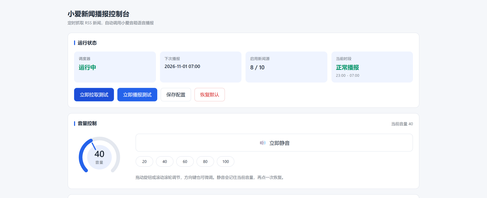
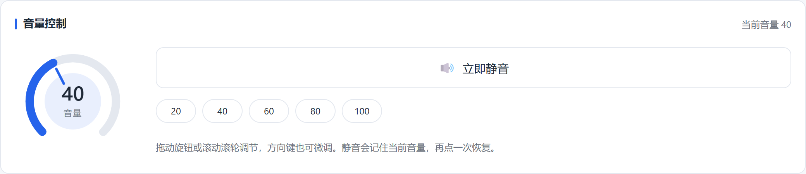
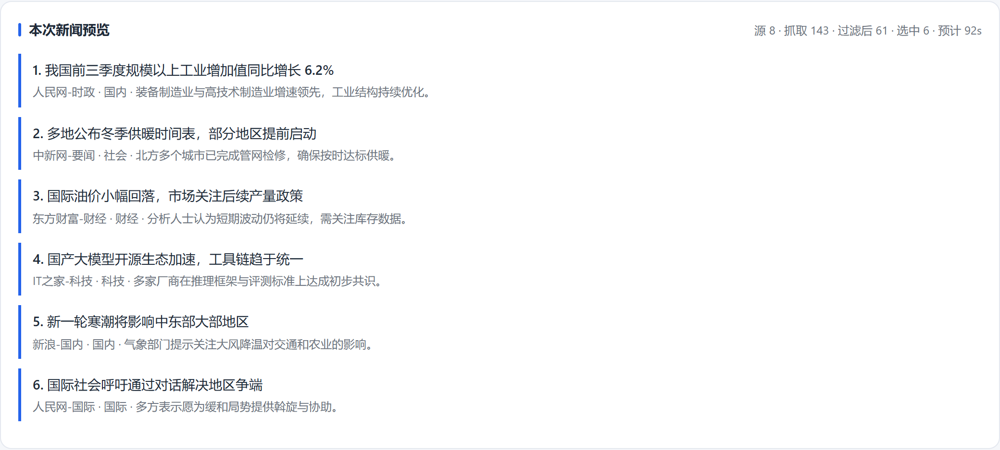

# 小爱新闻播报

[](LICENSE)
[](docker-compose.yml)

[](https://github.com/123ysz123/xiaoai-news/stargazers)
[](https://github.com/123ysz123/xiaoai-news/commits/main)

给 [xiaomusic](https://github.com/hanxi/xiaomusic) 加一套**新闻播报服务**和**TTS 网关**：每天定时抓取 RSS 新闻，合成语音，让小爱音箱自己念出来。

全部功能跑在一个复用 xiaomusic 镜像的网关容器里，不新增镜像、不改动 xiaomusic 源码。

## 界面

单页控制台，无前端框架、无构建步骤。运行状态、音量旋钮、整点排期、新闻源管理、内容规则、播报预览和运行日志都在这一页：



拖动旋钮、滚轮或方向键都能调音量，静音会记住当前音量，再点一次自动恢复：



点「立即拉取测试」只采集不播报，先看清这次会念哪几条、大概多久：



> 截图中的新闻条目为示例数据，实际内容取决于你启用的源和当天的新闻。

## 架构

```
┌──────────────────────────────────────────────────────────────┐
│  浏览器  http://<host>:58091/news                             │
└───────────────────────────┬──────────────────────────────────┘
                            │
┌───────────────────────────▼──────────────────────────────────┐
│  xiaomusic-gateway  (FastAPI + uvicorn, :8091 → 宿主 58091)   │
│                                                              │
│  /health  /tts  /devices      ← TTS 网关（原有能力）          │
│  /news/api/*                  ← 新闻服务 REST 接口            │
│  /news                        ← 单页控制台（静态文件）        │
│                                                              │
│  ┌────────────┬────────────┬────────────┬─────────────────┐  │
│  │ APScheduler│  collector │ broadcaster│  store          │  │
│  │ 整点定时   │  RSS 采集  │  调 TTS    │  配置/历史/日志 │  │
│  └────────────┴────────────┴────────────┴─────────────────┘  │
└───────────────────────────┬──────────────────────────────────┘
                            │ HTTP
┌───────────────────────────▼──────────────────────────────────┐
│  xiaomusic  (:8090 → 宿主 58090)                              │
│  /playtts  /getvolume  /setvolume  /device_list              │
└───────────────────────────┬──────────────────────────────────┘
                            │ 小米云 IoT
                       ┌────▼─────┐
                       │ 小爱音箱 │
                       └──────────┘
```

---

## 功能

**新闻播报**

- 19 个内置中文 RSS 源（人民网 / 中新网 / 新浪 / 东方财富 / IT之家 等），可自由增删、排序、启停
- 整点定时播报，支持任意小时组合、静音时段（可跨零点）
- 采集规则：分类过滤、条数上限、单条字数上限、总时长上限、24 小时去重
- 轮询合并算法，保证多来源混合而不是被同一个源刷屏
- 配置改动**热更新**，不需要重启容器
- 播报历史、运行日志、一键预览（只采集不播报）

**TTS 网关**

- `GET/POST /tts` —— 让音箱念任意文字，局域网内可直接调
- `GET /devices` —— 列出账号下的音箱
- 可选的 Bearer Token 鉴权（默认关闭）

**音量控制**

- 网页上的圆形旋钮，拖动 / 滚轮 / 方向键都能调
- 一键静音，记住静音前的音量，取消静音自动恢复
- 静音状态下直接拖旋钮会自动解除静音

---

## 快速开始

### 前置

- 已有一个能正常播放音乐的 xiaomusic 实例（小米账号已登录）
- Docker + Docker Compose

### 1. 准备配置

```bash
cp .env.example .env
```

编辑 `.env`，至少要改两项：

```ini
# Linux 宿主机用 docker0 网关地址；Windows/Mac 用 host.docker.internal
UPSTREAM=http://172.17.0.1:58090
# 音箱 DID，可从 /devices 接口查到
DEFAULT_DID=123456789
```

> 不知道 DID？先启动，然后 `curl http://127.0.0.1:58091/devices` 就能看到。

### 2. 构建并启动

```bash
docker compose up -d --build
```

第一次构建会拉取 `hanxi/xiaomusic:latest` 并打三个补丁，约 3~5 分钟。

### 3. 验证

```bash
curl http://127.0.0.1:58091/health
# {"status":"ok"}

curl -X POST http://127.0.0.1:58091/tts \
  -H "Content-Type: application/json" \
  -d '{"text":"网关已启动","did":"123456789"}'
# {"ok":true,"did":"123456789","text":"网关已启动"}
```

### 4. 打开控制台

浏览器访问 **http://&lt;宿主机IP&gt;:58091/news**

在「高级设置」里填好设备 DID，点「立即播报」试一次，再去「整点播报」勾选想要的时间。

---

## 目录结构

```
.
├── Dockerfile                 # 在官方镜像上打三个补丁
├── docker-compose.yml         # xiaomusic + gateway 两个容器
├── .env.example               # 环境变量模板
├── assets/                    # README 用的界面截图
├── gateway/
│   ├── gateway.py             # FastAPI 主应用：TTS 网关 + 新闻路由
│   ├── news/
│   │   ├── api.py             # REST 路由与入参校验
│   │   ├── auth.py            # 可选 Bearer Token 鉴权
│   │   ├── broadcaster.py     # 调上游 TTS 播报
│   │   ├── collector.py       # RSS 采集、清洗、去重、裁剪
│   │   ├── defaults.py        # 默认配置与内置源清单
│   │   ├── scheduler.py       # APScheduler 整点调度
│   │   ├── service.py         # 编排层
│   │   ├── store.py           # 配置/历史/日志持久化
│   │   └── volume.py          # 音量与静音
│   └── static/
│       ├── index.html         # 单页控制台
│       └── app.js             # 前端逻辑（无框架依赖）
└── client/
    └── xiaomusic_tts_client.py  # 纯标准库 TTS 客户端示例
```

---

## 配置

### 环境变量

| 变量 | 默认值 | 说明 |
|---|---|---|
| `UPSTREAM` | `http://host.docker.internal:58090` | 上游 xiaomusic 地址 |
| `DEFAULT_DID` | 空 | 默认音箱 DID；为空时必须每次显式传 `did` |
| `MAX_TEXT_LEN` | `500` | 单条 TTS 文本长度上限 |
| `AUTH_ENABLED` | `0` | `1` 开启 Bearer Token 鉴权 |
| `TTS_TOKEN` | `change-me-please` | 鉴权令牌，开启鉴权时**务必**改掉 |
| `NEWS_DIR` | `/data/news-service` | 新闻数据目录（配置/历史/日志/状态） |
| `NEWS_TZ` | `Asia/Shanghai` | 调度时区 |
| `NEWS_STATIC` | `<gateway>/static` | 前端静态目录 |

### 新闻服务配置

存在 `$NEWS_DIR/config.json`，网页上改完点保存即热更新。也可以直接 `POST /news/api/config`。

```jsonc
{
  "schedule": {
    "hours": [7, 8, 12, 18, 21],   // 播报整点
    "quiet_start": 23,             // 静音时段起（含）
    "quiet_end": 7                 // 静音时段止（不含），支持跨零点
  },
  "rules": {
    "categories": ["国内", "国际", "财经", "科技", "社会", "体育"],
    "max_items": 6,                // 每次最多播几条
    "max_chars_per_item": 60,      // 单条摘要截断字数
    "max_duration_sec": 180,       // 整段播报时长上限
    "dedup": true,                 // 开启去重
    "dedup_hours": 24,             // 去重窗口
    "chars_per_sec": 5.0           // 语速估算，用于算时长
  },
  "tts": {
    "did": "",                     // 留空用环境变量 DEFAULT_DID
    "url": "",                     // 留空走内部直连上游
    "intro": "现在为您播报新闻。",
    "outro": "以上就是本次新闻播报，再见。",
    "retry": 2,
    "timeout": 180
  },
  "history": { "keep_days": 7 }
}
```

---

## API

基址 `http://<host>:58091`。鉴权默认关闭；开启后需带 `Authorization: Bearer <TTS_TOKEN>`。

### TTS 网关

| 方法 | 路径 | 说明 |
|---|---|---|
| GET | `/health` | 健康检查 |
| GET | `/tts?text=...&did=...` | 让音箱念文字 |
| POST | `/tts` | 同上，body `{"text":"...","did":"..."}` |
| GET | `/devices` | 列出账号下的音箱 |

```bash
curl -X POST http://127.0.0.1:58091/tts \
  -H "Content-Type: application/json" \
  -d '{"text":"该吃饭了","did":"123456789"}'
```

> 接口是**异步受理**的：返回 `ok:true` 只代表小米云已接受指令，不代表已经播完。

### 新闻服务

| 方法 | 路径 | 说明 |
|---|---|---|
| GET | `/news/api/status` | 调度状态、下次播报时间、源数量 |
| GET | `/news/api/config` | 读取完整配置 |
| POST | `/news/api/config` | 保存配置（自动热更新） |
| POST | `/news/api/config/reset` | 恢复默认配置 |
| GET | `/news/api/sources` | 新闻源列表与分类 |
| POST | `/news/api/preview` | 只采集不播报，看会念什么 |
| POST | `/news/api/broadcast` | 立即播报一次 |
| GET | `/news/api/logs?limit=100` | 最近日志 |
| GET | `/news/api/history?limit=20` | 播报历史 |
| GET | `/news/api/volume` | 当前音量与静音状态 |
| POST | `/news/api/volume` | 设置音量 `{"volume":40}` |
| POST | `/news/api/mute` | 静音/取消 `{"mute":true}` |

`/news/api/status` 返回两个容易混淆的字段，注意区分：

- `next_scheduled` —— 下一个**定时任务触发点**，可能落在静音时段，届时会被跳过
- `next_run` —— 下一次**真正会播报**的时间，已跳过静音时段

网页上显示的是 `next_run`，所以夜间不会出现「下次播报 01:00」这种自相矛盾的提示。

---

## 三个必打的补丁

`Dockerfile` 里做的事，也是这个项目踩坑最多的地方。

### 1. edge-tts 令牌版本（TTS 无声）

基础镜像自带的 edge-tts 7.2.8 在 WSS 握手时发送：

```
Sec-MS-GEC-Version: 1-<chromium 版本>
```

微软服务端已要求版本号为 **v2**，于是握手直接返回 403，合成出 0 字节 mp3，音箱去拉流拿到 HTTP 416。

```
升级前：音频时长 0s，mp3 大小 0B，拉流 416
升级后：音频时长 104s，mp3 大小 15KB，拉流 206
```

修复方式就是升到 7.3.1：

```python
# edge_tts/constants.py 7.3.1
SEC_MS_GEC_VERSION = f"2-{CHROMIUM_FULL_VERSION}"
```

排查时已经排除过时钟偏差、DNS 污染、token 失效、代理缺失——用参数矩阵（带/不带 GEC、有无 deflate、有无 Origin、无 Cookie）跑下来全部 403，才定位到令牌版本。

### 2. 音量调不动的 media 通道

`miservice` 的 `player_set_volume()` 硬编码了 `media="app_ios"`：

```python
{"volume": volume, "media": "app_ios"}
```

小米 AI 音箱（S12A）不认这个通道——**接口返回 `code:0`，音量纹丝不动**。实测改成 `common` 才生效：

```python
{"volume": volume, "media": "common"}
```

所以 Dockerfile 里用 sed 在构建时改掉：

```dockerfile
sed -i 's/{"volume": volume, "media": "app_ios"}/{"volume": volume, "media": "common"}/' "$F"
```

### 3. 依赖

`feedparser` 用于解析 RSS。`APScheduler` / `FastAPI` / `uvicorn` 基础镜像已自带，不需要额外安装。

---

## 常见问题

**音箱没声音，但接口返回 `ok:true`**

先确认 TTS 本身是否正常：

```bash
docker exec xiaomusic-gateway /app/.venv/bin/python3 -c \
  "import edge_tts.constants as c; print(c.SEC_MS_GEC_VERSION)"
# 应该输出 2-xxxx，输出 1-xxxx 说明 edge-tts 补丁没生效
```

**音量能读到但改不了**

```bash
docker exec xiaomusic-gateway grep -n 'media' \
  /app/.venv/lib/python3.*/site-packages/miservice/minaservice.py | grep volume
# 应该是 media": "common"
```

**改了配置不生效**

配置是热更新的，保存后立刻生效。如果改的是 `.env`，需要 `docker compose up -d` 重建容器。

**某个 RSS 源一直失败**

部分源对 UA 或频率敏感。控制台「日志」区会显示 `源拉取失败 xxx`，把该源关掉即可。单源失败不影响其它源。

**`/news` 打开是 404**

确认 `NEWS_STATIC` 指向的目录被挂载进了容器，且 `gateway/static/` 下有 `index.html`。

**容器重建后配置丢了**

检查 `./data/news-service` 是否挂载到容器内的 `/data/news-service`。这是唯一的数据目录。

---

## 客户端示例

`client/xiaomusic_tts_client.py` 是纯标准库实现，不需要 pip 装任何东西：

```bash
export XM_HOST=192.168.1.100
export XM_DID=123456789

python client/xiaomusic_tts_client.py --devices
python client/xiaomusic_tts_client.py "你好，世界"
python client/xiaomusic_tts_client.py "指定设备播报" --did 987654321
```

也可以当模块用：

```python
from xiaomusic_tts_client import XiaoMusicTTS

tts = XiaoMusicTTS(host="192.168.1.100", port=58091)
tts.speak("服务器 CPU 温度超过 80 度")
```

---

## 许可证与致谢

本项目以 **MIT** 许可发布，见 [LICENSE](LICENSE)。

### 关于 xiaomusic

**本项目没有复制 [hanxi/xiaomusic](https://github.com/hanxi/xiaomusic) 的任何源代码**，只做两件事：

1. 以 `FROM hanxi/xiaomusic:latest` 为基础镜像，在构建时用 `pip` 和 `sed` 打补丁
2. 在运行时通过 HTTP 调用它的 `/playtts`、`/getvolume`、`/setvolume`、`/device_list` 接口

因此**不构成衍生作品**，不必沿用它的许可证。但出于尊重，仍然在此明确致谢：

> **xiaomusic** —— MIT License, Copyright (c) 2024 涵曦
> https://github.com/hanxi/xiaomusic
>
> 一个把小米 AI 音箱改造成网络音乐播放器的开源项目。没有它，本项目无从谈起。

同时致谢：

- **miservice_fork** —— MIT License。xiaomusic 依赖的小米云 IoT 接口封装，音量补丁正是改的这里。
- **edge-tts** —— 微软 Edge 在线语音合成。
- **FastAPI** / **APScheduler** / **feedparser** —— 各自遵循其开源许可。

### 免责

本项目仅供个人学习与自用。抓取 RSS 内容用于个人播报，请遵守各新闻源的服务条款；请勿用于商业转播或公开传播。小米账号、设备凭据等敏感信息请自行妥善保管，不要提交到仓库。

本项目调用小米云 IoT 接口控制音箱，可能违反小米服务协议中关于「不得修改交互数据」的条款，使用可能导致账号受限或封禁，风险由使用者自行承担。

本项目调用的 Edge TTS 服务及抓取的 RSS 新闻内容，其使用条款和著作权归属各自的权利人。请勿将本项目用于商业用途或公开传播。
